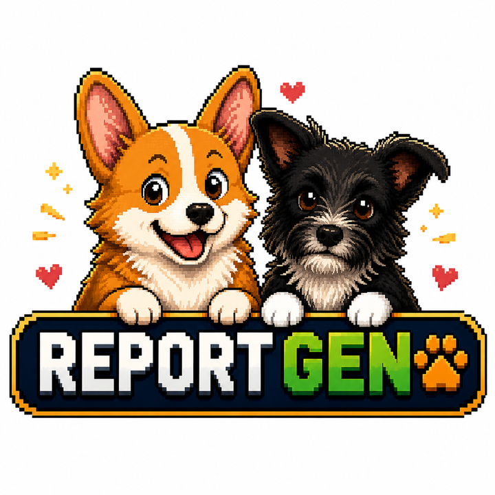

<p align="center">
  
</p>

<a id="report-gen"></a>

# report-gen 0.27.0

<a id="qué-es"></a>

**Un editor local para convertir tus evaluaciones de seguridad en informes claros.** Organiza hallazgos, conecta evidencias, registra remediación y retest, y prepara **PDF, Word, Markdown con imágenes y HTML portátil** desde una revisión guardada.

[English](README.en.md) · [Guía completa](docs/guide.es.md) · [Cambios](CHANGELOG.md) · [Seguridad](SECURITY.md)

<a id="inicio-rápido"></a>

## Instalar y abrir

Ruta principal: **Linux/Kali y Python 3.10+**. La guía detalla los requisitos y las opciones de instalación.

```bash
git clone https://github.com/IphobiusS/report-gen.git
cd report-gen
python3 start.py --ready
```

Abre **http://127.0.0.1:8080** en tu navegador. `Ctrl+C` detiene el servidor; `--port 8081` permite elegir otro puerto local.

`--ready` prepara `.venv` si hace falta, comprueba los motores y abre el editor. La instalación inicial descarga dependencias con las restricciones de `requirements-audited.txt`. Los motores opcionales ausentes se indican por separado. Para bibliotecas nativas de PDF, consulta [la instalación detallada](docs/guide.es.md#instalar-y-abrir). **Node.js no es necesario para usar el editor.**

<a id="demo"></a>

## Primer informe

1. En **Inicio**, elige **Probar demo Nimbus**: crea una copia editable de un caso ficticio con 12 hallazgos. Para tu propio trabajo, usa **Crear mi proyecto**.
2. En el proyecto, **Siguiente acción sugerida** te orienta según lo que ya has escrito. **Ver este paso en la guía** abre la ayuda correspondiente. La ayuda no completa ni valida los datos de tu evaluación por ti.
3. Guarda, revisa el **Inspector de publicación** y genera los formatos que necesites desde **Entregar**. Abre los archivos antes de compartirlos y conserva un respaldo privado del proyecto.

[Recorrido completo y recomendaciones](docs/guide.es.md#primer-informe).

<a id="características"></a>

## Qué puedes hacer

- **Documentar una evaluación:** alcance, metodología, activos, cobertura, hallazgos y pasos reproducibles; CVSS 3.1 y 4.0 cuando corresponda.
- **Trabajar con evidencia:** galería, pies de imagen, vínculos a hallazgos, copias censuradas e inspección de lo que se publicará.
- **Conservar el seguimiento:** identidades estables, revisiones recuperables, comparación con una entrega marcada, correcciones y matriz de retest.
- **Elegir la presentación:** empezar con Serio, comparar los seis diseños generales y abrir el catálogo especializado cuando lo necesites. El idioma del informe es independiente del de la interfaz.
- **Separar destinatarios:** entregas técnica, ejecutiva y pública con planes de inclusión explícitos; la pública requiere texto aprobado y consentimiento registrado.
- **Relacionar evidencia y decisiones:** afirmaciones, límites, contexto de negocio, observaciones y revisión visual del PDF. [Flujo y requisitos opcionales](docs/evidence-decisions-0230.md).

| Formato | Archivo que recibes |
| --- | --- |
| PDF | Informe paginado `.pdf`. |
| Word | Documento editable `.docx`, con campos propios para el índice. |
| Markdown | ZIP con `report.md` y sus imágenes. |
| HTML portátil | Un `.html` autónomo con filtros de lectura. |

## Novedades de 0.27.0

Recuperación explícita de capturas y formularios pendientes, importación de Nuclei y Nmap, revisión OCR local opcional y respaldos privados cifrados. La revisión nativa en Word y las cinco sesiones con participantes siguen pendientes; se incluyen materiales ficticios para realizarlas. [Cambios completos](CHANGELOG.md).

## Qué comprueba cada entrega

**Ver comprobaciones** muestra revisión, SHA-256, tamaño y controles por archivo. Las exportaciones comparan contenido y referencias con alcances distintos según el formato. **Estas comprobaciones no certifican la validez del pentest ni la presentación visual:** revisa PDF, Word, Markdown y HTML antes de entregar.

[Contratos de exportación, anexos y límites](docs/guide.es.md#qué-comprueba-cada-entrega). La [firma Ed25519 opcional](docs/delivery-signing.md) acredita integridad respecto de una clave pública fijada; no cifra la entrega ni certifica sus conclusiones.

<a id="por-qué-está-construido-así"></a>
<a id="modelo-de-uso-y-límites"></a>

## Datos y recuperación

El editor trabaja en **`127.0.0.1` y un solo proceso**, sin cuentas ni servicios externos para la edición normal. Después de instalar sus dependencias, el trabajo habitual es local. La asistencia con Ollama es **opcional y explícita**; consulta qué campos envía y sus límites antes de activarla.

Los proyectos están en `webapp/projects/` y las bibliotecas personales en `webapp/library/`. **Respaldo integral** conserva proyectos, originales e historial; es material privado. Los proyectos en disco y borradores del navegador no están cifrados por la aplicación. El respaldo descargado puede cifrarse con contraseña instalando la opción `privacy`; no cifra la instalación ni sustituye conservar la contraseña. [Recuperación, copias y privacidad](docs/guide.es.md#datos-y-recuperación).

El HTML portátil contiene el informe completo: sus filtros no son permisos de acceso. Los detectores de posibles secretos no sustituyen la revisión humana. Las pruebas de compatibilidad de Windows no sustituyen la revisión en Microsoft Word de escritorio; Word y LibreOffice pueden paginar de forma distinta. Los perfiles de certificación no implican afiliación ni garantizan cumplir las reglas de un examen.

<a id="actualizar-sin-perder-proyectos"></a>

## Actualizar desde una versión anterior

Descarga **0.27.0 en una carpeta nueva**, detén la instalación anterior y ejecuta desde la nueva:

```bash
python3 start.py --ready --upgrade-from /ruta/report-gen-anterior
```

El traslado exige un destino sin proyectos ni bibliotecas personales; conserva el origen y genera un respaldo privado. Comprueba tus proyectos antes de retirar la instalación anterior. También puedes trasladarlos mediante **Respaldo integral**. No copies la `.venv` antigua.

[Compatibilidad de respaldos y recuperación de proyectos antiguos](docs/guide.es.md#actualizar-desde-una-versión-anterior).

<a id="cli--uso-avanzado"></a>

## Exportar por terminal

Prueba un ejemplo ficticio incluido, desde la raíz del proyecto:

```bash
.venv/bin/python export.py examples/pending-severity/engagement.yaml -f html -o out/ejemplo.html
```

Los valores de `-f` son `pdf`, `docx`, `md` y `html`; `md` produce un ZIP. [Más sobre CLI, Word e imágenes](docs/guide.es.md#exportar-por-terminal).

<a id="pruebas-de-desarrollo"></a>

## Desarrollo y límites

Para desarrollo y pruebas de interfaz se necesita **Node.js 22+**. Desde un entorno ya instalado:

```bash
.venv/bin/python -m pip install -e '.[dev]' -c requirements-audited.txt
npm ci
.venv/bin/python -m pytest
npm test
```

[Pruebas de navegador y escenarios opcionales](docs/guide.es.md#desarrollo-y-límites) · [Contribuir](CONTRIBUTING.md) · [Seguridad](SECURITY.md) · [Licencia MIT](LICENSE).

## Documentación

- [Guía de uso: instalación, publicación, respaldo, CLI y desarrollo](docs/guide.es.md).
- [Evidencia y decisiones; vistas previas y Ollama opcionales](docs/evidence-decisions-0230.md).
- [CVSS 4.0](docs/CVSS40.md) y [firma de entregas](docs/delivery-signing.md).
- [Biblioteca de diseños y plantillas](docs/design-library.md).
- [Registro de cambios](CHANGELOG.md).
